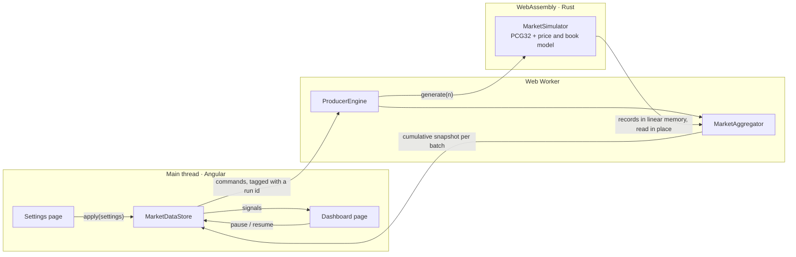

# Market Monitor

A realtime market dashboard: an Angular 22 UI over a market simulator written in Rust, compiled to
WebAssembly and run in a Web Worker.

**Live demo:** https://realtime-market-dashboard.ppdevart.workers.dev

Every push to `main` deploys there; every other branch gets its own preview URL (see
[Deployment](#deployment)). The footer names the commit the page was built from.

## What it does

- **Dashboard.** One row per instrument with last traded price, bid–ask spread, cumulative volume,
  cumulative VWAP and order-book imbalance, plus the producer's status and a Pause/Resume control.
- **Settings.** Instrument count, updates per batch and batch interval, validated as integers in
  their ranges. Nothing changes until _Apply settings_, which starts a new run and clears the
  previous run's values.
- **Producer.** The Rust generator emits market updates — one trade plus the book after it —
  in batches. The worker folds every trade into per-instrument totals; the UI renders the latest
  totals once per animation frame.

## Architecture



| Layer                    | Code                                   | Responsibility                                                                  |
| ------------------------ | -------------------------------------- | ------------------------------------------------------------------------------- |
| Generator (Rust → Wasm)  | `wasm/market-sim`                      | Randomness, price and book model, batches of 28-byte records                    |
| Engine (worker)          | `src/app/producer`                     | Run lifecycle, batch timing, reading batches out of Wasm memory                 |
| Domain (pure TypeScript) | `src/app/domain`                       | Metric formulas, aggregation, settings and their limits, message protocol       |
| Data layer (main thread) | `src/app/market-data`                  | The single producer, run isolation, frame-paced rendering state, failure states |
| UI                       | `src/app/features`, `layout`, `shared` | Pages, table, controls, formatting                                              |

The domain layer has no Angular and no DOM or worker globals; the same files run in the worker
and in the UI, and the worker program is type-checked against the WebWorker library.

## Decisions and why

Each decision is recorded with its context, consequences and rejected alternatives in
[`docs/adr`](docs/adr/README.md).

**Rust for the generator.** The assignment requires randomness and price logic to really run in
Wasm. Rust gives a small module (about 20 KB, 9.7 KB gzipped) with no runtime, and native unit
tests for the model. The RNG is a line-by-line port of the PCG32 reference, checked against its
published test vectors, and the model uses only correctly rounded floating-point operations, so a
seed produces the same stream natively and in Wasm. One golden fixture is shared by the Rust
tests and by the TypeScript contract test against the compiled module.

**The price model** is a mean-reverting relative deviation around a per-instrument anchor, in
trade time (activity drives price change, not wall-clock time), with a two-sided book that
drifts towards a typical depth. Every trade executes at that update's bid or ask, against a side
that displays quantity; the reported book is the state after the trade. Calibration, invariants
and why `exp`/`ln` are avoided are documented in `wasm/market-sim/src/instrument.rs`.

**Batches are read in place.** `generate` fills a buffer allocated once per simulator and returns
its address; the worker decodes records straight from a `Uint32Array` over Wasm memory. No batch
is copied or turned into objects, at any rate. The view is recreated only after memory growth,
and is never stored or posted (structured clone would copy all of linear memory).

**Metrics are computed in the worker.** Every trade is counted there exactly once, before any
throttling, and the UI receives one cumulative snapshot per batch: its size depends on the
number of instruments, not on the update rate. Volume and notional are exact integers in doubles
for at least 2.9 × 10⁸ trades per instrument (hours at the maximum rate); past that the relative
error stays far below a cent. Calculated prices are rounded only by the view.

**A run id isolates runs.** Every command and event carries the id of the run it belongs to, and
the store reads events through a per-run projection (`switchMap`). Anything still queued from a
replaced run — including a snapshot already waiting for an animation frame — is discarded. The
marble tests fail if the projection becomes a `mergeMap` or the run filter is removed.

**Snapshots are conflated to animation frames.** They are cumulative, so dropping all but the
latest loses nothing. With at most 20 batches per second this is not a throughput optimisation:
it bounds render work after a long task and does no rendering at all in a hidden tab.

**One producer for the life of the app.** The store is a root service started by an app
initializer, so the run and its paused state survive navigation and navigation cannot create a
producer. A new run replaces the generator inside the same worker (the old one is stopped and
freed first, so a replaced run can never keep generating unseen); a failed worker is replaced as a
whole, because a trapped Wasm instance may be corrupt.

**A native table, not a virtualised list.** Fifty rows render cheaply; real rows keep
find-in-page and screen-reader table navigation. Rows are tracked by symbol, so a frame only
patches the text that changed, and columns have fixed widths so values never jitter.

**Eager routes.** Lazy-loading the settings page would take about 22 KB (gzipped) of forms code
off the first load, but a tab opened before a deploy would then fail to load the replaced chunk
on its next navigation, which is exactly what happens when a change is pushed during a demo.

## Requirements map

| Requirement                                                              | Where                                                                                                       |
| ------------------------------------------------------------------------ | ----------------------------------------------------------------------------------------------------------- |
| Five metrics, cumulative, every trade counted once                       | `domain/market-metrics.ts`, `domain/market-aggregator.ts`                                                   |
| Unavailable before data and on zero denominators; currency and ±1 format | `market-metrics.ts` returns `null`; `features/dashboard/market-table.html`, `shared/format`                 |
| Pause/Resume and producer status; no data for the paused interval        | `producer/producer-engine.ts`, `features/dashboard/producer-controls.ts`, `layout/producer-status-badge.ts` |
| Validated settings; Apply starts a new run, also from a pause            | `features/settings`, `domain/producer-settings.ts`, `market-data/market-data.store.ts`                      |
| Navigation keeps the run; no extra producers; no stale results           | `market-data/market-data.store.ts`, `app.config.ts`                                                         |
| Generator in Wasm with state, requested batch sizes, valid values        | `wasm/market-sim`                                                                                           |
| Runs in a Web Worker; initialisation errors; resource cleanup            | `producer/producer.worker.ts`, `producer/wasm-market-source.ts`, `market-data/worker-producer-transport.ts` |

## Running locally

Prerequisites:

- Node.js 24.15 or later (`.nvmrc` pins the version CI uses).
- Rust through [rustup](https://rustup.rs). The toolchain, its components and the `wasm32` target
  are pinned in `rust-toolchain.toml` and installed on first use.
- wasm-pack 0.15: `cargo install wasm-pack --locked --version 0.15.0`.

```bash
npm ci
npm start        # builds the Wasm module, then serves http://localhost:4200
```

## Testing

```bash
npm test           # TypeScript: unit, component, marble and Wasm contract tests (Vitest)
npm run test:rust  # Rust: generator tests (cargo test)
npm run verify     # everything CI checks: formatting, ESLint, Stylelint, rustfmt and Clippy,
                   # type-checking (app, specs and worker), all tests and the production build
```

No test waits in real time: the engine runs on a manual clock, the store's timing is tested with
RxJS marble tests (animation frames included), and the components run zoneless.

| What                                                    | Tests                                                                             |
| ------------------------------------------------------- | --------------------------------------------------------------------------------- |
| Worked example, zero denominators, instrument isolation | `market-metrics.spec.ts`, `market-aggregator.spec.ts`                             |
| Settings validation and reset on Apply                  | `producer-settings.spec.ts`, settings page specs, `market-data.store.spec.ts`     |
| Pause/resume, stale-run rejection, startup failures     | `producer-engine.spec.ts`, `market-data.store.spec.ts`                            |
| Generator batch sizes and value invariants              | `wasm/market-sim` (Rust), `wasm-market-source.contract.spec.ts` (compiled module) |
| One producer across navigation                          | `app.spec.ts`                                                                     |

## Deployment

GitHub Actions runs on every push: a Rust job (rustfmt, Clippy for native and wasm32, tests) and a
web job (Wasm build, formatting, lint, type-check, tests with coverage, production build). When
both pass, the build is published to Cloudflare Workers static assets: `main` with
`wrangler deploy`, any other branch as a version with a public preview alias. Nothing is deployed
by hand.

- HTML is served with `max-age=0, must-revalidate`, so a deploy is visible on the next load;
  fingerprinted scripts, styles, fonts and the `.wasm` are immutable.
- Deep links such as `/settings` get the app shell with a 200. A three-line Worker answers 404 for
  missing assets, so a missing script never receives the HTML shell under a cacheable script URL.
- `npm audit` for production dependencies is a separate check that does not gate deploys, so an
  advisory published upstream cannot freeze the demo.

## Performance

Measured on the production build at the maximum settings (50 instruments, 1,000 updates every
50 ms), over 10 seconds in Chrome 155 on an Apple-silicon laptop:

| Measure                       | Result                                           |
| ----------------------------- | ------------------------------------------------ |
| Updates processed             | 19,982 per second (20,000 nominal)               |
| Long tasks on the main thread | none                                             |
| Frame rate                    | 121.8 fps on a 120 Hz display; worst frame 11 ms |
| JavaScript heap (main thread) | 6 MB                                             |
| Generator                     | about 25 µs per 1,000-update batch in Wasm       |

Payloads, gzipped: application 104 KB, worker 3.4 KB, Wasm module 9.7 KB, styles 1.1 KB.

## Trade-offs and known limits

- Pause and resume update the UI immediately rather than waiting for the worker to confirm.
  Commands are delivered in order, and the only way one could be lost is the worker dying, which
  is reported as an error.
- A snapshot generated just before a pause can still arrive after it; it is accepted, because
  those trades happened before the pause.
- The price model runs in trade time: at very high rates prices move faster on screen, never
  further. It is a demo feed, not an exchange model.

## What I would do next

- Move snapshots to a `SharedArrayBuffer` ring buffer to drop the per-batch `postMessage` (needs
  cross-origin isolation headers).
- Credit-based backpressure, so the worker never produces faster than the UI consumes.
- Row virtualisation or a canvas grid if the instrument count grew into the hundreds.
- Browser end-to-end tests in CI against each preview URL.
